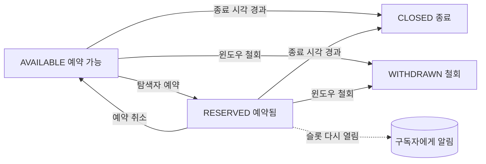
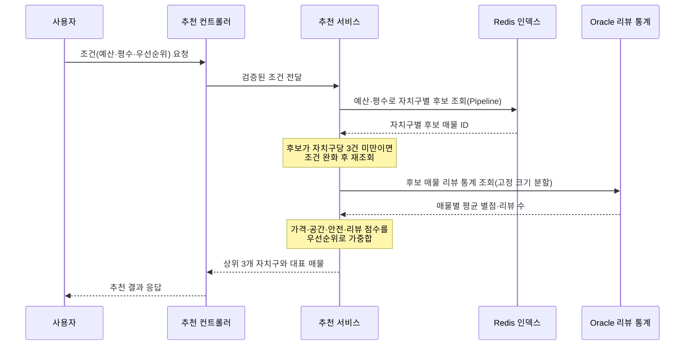
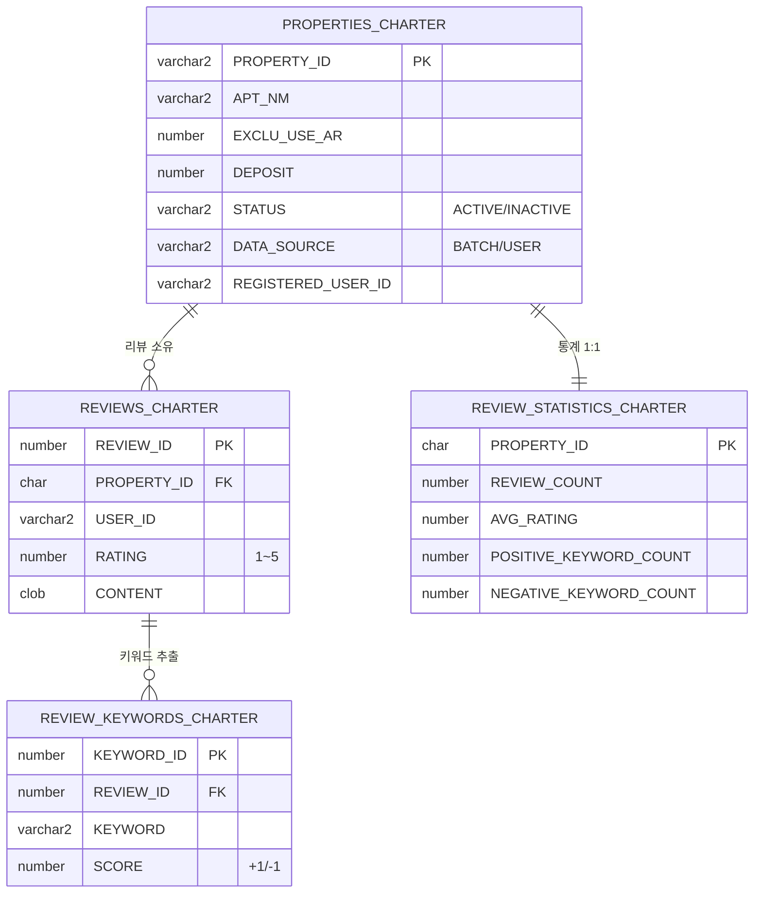
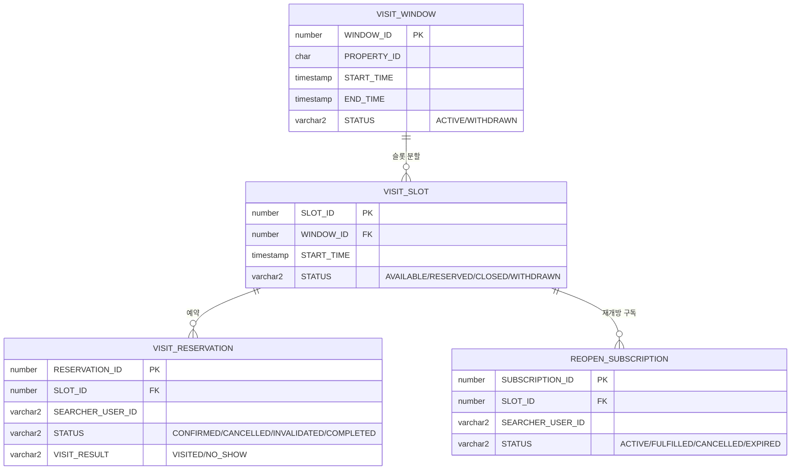

# WhereHouse · 서울 1인 가구 주거지 추천 서비스


> 흩어진 공공데이터(가격·안전·편의)와 실거주자 리뷰를 하나의 추천 점수로 합쳐, 예산·평수·안전 조건에 맞는 서울 자치구와 매물을 추천하고, 지도에서 고른 위치의 안전·편의를 그 자리에서 분석해 준다.

| 항목 | 내용 |
|---|---|
| 개발 형태 | 학원 팀 프로젝트로 만든 초기 버전(단순 CRUD·필터링 추천)을 이후 백엔드 1인이 전면 재설계. 요구사항 정의, DB 스키마 설계, API·비즈니스 로직, 데이터 배치, Ubuntu 서버 배포까지 담당 |
| 대표 시나리오 | 조건(예산·평수·우선순위)으로 서울 자치구를 추천받고, 상세 지도에서 임의 위치의 안전·편의 점수를 확인한다 |
| 규모 | 도메인 7개(추천·리뷰·매물·방문예약·위치정보·회원·게시판), 컨트롤러 17개, 엔드포인트 60여 개, Oracle 테이블 30여 개 |
| 배포 | wherehouse.it.kr (개인 Ubuntu 서버)에 운영. 성능 측정은 모두 로컬 기계 한 대에서 진행했고, 본문 수치도 그 로컬 측정값이다 |

## 목차

1. [프로젝트 소개](#1-프로젝트-소개)
2. [기획 배경](#2-기획-배경)
3. [주요 기능](#3-주요-기능)
4. [구현 화면](#4-구현-화면)
5. [기술 스택](#5-기술-스택)
6. [기술적 이슈와 해결 과정](#6-기술적-이슈와-해결-과정)
7. [시스템 아키텍처](#7-시스템-아키텍처)
8. [ERD](#8-erd)
9. [API](#9-api)
10. [프로젝트 구조](#10-프로젝트-구조)

---

## 1. 프로젝트 소개

WhereHouse는 서울에서 혼자 살 집을 찾는 사람이 가격과 안전과 생활 편의를 한 화면에서 비교하도록 돕는 서비스다.

집을 고를 때 봐야 하는 정보는 여러 곳에 흩어져 있다. 전세가와 월세가는 부동산 서비스에, 치안은 경찰과 CCTV 통계에, 생활 편의는 편의점·마트·병원 위치에 따로 있다. 사용자는 이 정보를 각각 찾아 머릿속에서 합쳐야 한다.

WhereHouse는 이 흩어진 공공데이터를 안전 점수와 편의 점수로 정규화한 뒤 사용자가 정한 우선순위로 가중합해, **하나의 추천 점수로 자치구와 매물의 순위를 매겨 보여 준다.**

여기에 공공데이터만으로는 알 수 없는 것을 더한다. 소음, 채광, 이웃 분위기 같은 실제 거주 경험이다. **실거주자가 남긴 별점과 리뷰도 똑같이 점수로 바꿔서, 매물당 리뷰가 5건 이상 쌓이면 추천 점수에 절반의 비중으로 더한다.** 리뷰가 부족한 매물은 기존 공공데이터 점수를 그대로 쓰므로, 리뷰가 없는 매물도 추천에서 빠지지 않는다.

추천 후보는 두 단계로 좁힌다. 먼저 사용자의 예산·평수 조건으로 매물을 거르고, 조건을 만족하는 매물이 자치구당 3건에 못 미치면 덜 중요한 순위의 조건부터 완화해 다시 검색한다. 그 뒤 남은 후보의 가격·공간·안전·리뷰 점수를 우선순위 가중치로 합쳐 자치구를 순위 매기고, 사용자가 자치구를 고르면 그 안의 매물을 지도 위에 올려 준다.

---

## 2. 기획 배경

### 2.1 시중 부동산 서비스는 가격 옆에 안전과 편의를 놓지 않는다

혼자 사는 사람이 집을 고를 때 가장 크게 걸리는 것은 가격만이 아니라 그 동네가 안전한지, 생활이 편한지다. 그런데 시중 서비스는 이 셋을 한자리에 놓지 않는다.

| 서비스 | 어디까지 보여 주나 | 무엇을 하지 않나 |
|---|---|---|
| 직방 · 다방 | 매물 중심으로 가격·사진·평면도를 보여 준다 | 지역의 치안·생활 편의를 점수로 비교해 주지 않는다 |
| 네이버 부동산 | 실거래가 중심으로 시세를 보여 준다 | 지역 단위 생활 정보가 부족하다 |

셋 다 가격은 잘 보여 주지만, 안전과 편의를 가격과 같은 화면에서 비교하게 해 주지는 않는다. WhereHouse는 안전·편의·가격을 하나의 추천 점수로 종합하고, 여기에 실거주자 리뷰도 같은 점수로 바꿔 함께 반영한다.

### 2.2 리뷰는 통계적으로 믿을 만한 수가 쌓였을 때만, 정량 점수와 같은 무게로 반영한다

리뷰를 추천에 넣을 때 가장 조심한 것은 소수 리뷰의 편향이다. 한두 명의 후한 별점이 자치구 순위를 흔들면 추천을 믿을 수 없다. 그래서 누가 무엇을 정하고 그것이 어디에 쓰이는지를 다음처럼 정했다.

| 정하는 것 | 규칙 | 쓰이는 곳 |
|---|---|---|
| 리뷰 반영 조건 | 매물당 리뷰 5건 이상일 때만 반영 | 5건 미만이면 기존 공공데이터 점수를 100% 사용 |
| 리뷰 점수 | 별점 점수와 키워드 점수를 절반씩 가중합 | 별점 점수 = (평균 별점 / 5) × 100, 키워드 점수 = 긍정 / (긍정 + 부정) × 100 |
| 키워드 | 리뷰 본문에서 사전 정의한 긍정·부정 키워드를 뽑아 +1 / -1 | 키워드가 하나도 없으면 중립 50점 |
| 최종 점수 | 기존 점수와 리뷰 점수를 절반씩 가중합 | 최종 점수 = (기존 점수 × 0.5) + (리뷰 점수 × 0.5) |

5건이라는 기준은 통계적으로 믿을 만한 최소한의 리뷰 수다. 별점만 쓰지 않고 본문에서 키워드도 함께 뽑는 것은, 별점은 후하게 줬지만 본문에는 불만을 적은 경우를 놓치지 않기 위해서다. 위 비율과 임계값은 실제 추천 서비스 코드(`CharterRecommendationService`)에 그대로 들어가 있다.

### 2.3 필요한 것을 기능으로 옮겼다

| 필요한 것 | 그것이 만든 기능 |
|---|---|
| 가격뿐 아니라 안전·편의까지 한 번에 비교하고 싶다 | 공공데이터를 안전·편의·가격 점수로 정규화하고 우선순위로 가중합하는 자치구 추천 |
| 통계뿐 아니라 실제 살아 본 사람 평가도 보고 싶다 | 별점·본문 리뷰 수집, 키워드 자동 추출, 리뷰 점수의 제한적 반영 |
| 조회 조건에 맞는 결과를 최대한 받고 싶다 | 결과가 자치구당 3건 미만이면 덜 중요한 조건부터 완화해 다시 검색하는 2단계 폴백 |
| 지도에서 고른 위치가 실제로 안전한지 보고 싶다 | 임의 좌표의 반경 500m CCTV 수, 가까운 파출소 거리, 편의시설을 조회해 점수화하는 상세 지도 |
| 마음에 든 매물을 직접 보러 가고 싶다 | 등록자가 방문 가능 시간을 공개하고 탐색자가 슬롯을 예약하는 방문 예약 |

읽는 사람은 서울에서 혼자 살 집을 찾는 사람이다.

상세한 기획 근거는 저장소의 [기획서](docs/11.%20%EC%A3%BC%EA%B1%B0%EC%A7%80%20%EC%B6%94%EC%B2%9C%20%EC%84%9C%EB%B9%84%EC%8A%A4%20%EC%82%AC%EC%9A%A9%EC%9E%90%20%EA%B2%BD%ED%97%98%20%EB%B0%98%EC%98%81%20%EA%B0%9C%EC%84%A0/1.%20%EC%A3%BC%EA%B1%B0%EC%A7%80%20%EC%B6%94%EC%B2%9C%20%EC%84%9C%EB%B9%84%EC%8A%A4%20%EC%82%AC%EC%9A%A9%EC%9E%90%20%EA%B2%BD%ED%97%98%20%EB%B0%98%EC%98%81%20%EA%B0%9C%EC%84%A0%20%EA%B8%B0%ED%9A%8D%EC%84%9C.md)에 있다.

---

## 3. 주요 기능

기능은 다섯 갈래다. 각 기능이 무엇을 받아 무엇을 하고 무엇을 내는지 정리했다. '하는 일'은 코드에서 확인한 실제 검사와 계산이다.

| 기능 | 입력 | 하는 일 | 출력 |
|---|---|---|---|
| 자치구 추천 | 임대 형태, 예산·평수 범위, 우선순위 3개 | 예산·평수로 후보 매물을 거르고, 자치구당 3건 미만이면 조건을 완화해 다시 검색한 뒤, 가격·공간·안전·리뷰 점수를 우선순위로 가중합 | 상위 3개 자치구와 자치구별 대표 매물·추천 점수·추천 근거 |
| 상세 지도 분석 | 지도에서 고른 좌표 | 반경 500m CCTV 수, 가장 가까운 파출소 거리, 편의시설 15개 종류를 조회해 안전·편의 점수로 정규화 | 종합·안전성·편의성 점수와 인근 시설 목록 |
| 실거주자 리뷰 | 별점(1~5), 본문 텍스트 | 본문에서 긍정·부정 키워드를 뽑아 점수화하고, 매물별 평균 별점·리뷰 수 통계를 같은 트랜잭션에서 갱신 | 리뷰 목록, 매물별 통계, 추천에 반영할 리뷰 점수 |
| 사용자 매물 등록 | 아파트명·층·전용면적·가격 등 매물 속성 | 시군구·지번·아파트명·층·전용면적으로 매물 식별자를 만들어 중복을 막고, 원본은 Oracle에, 추천용 인덱스는 Redis에 반영 | 등록된 매물과 상태(활성·비활성) |
| 방문 예약 | 등록자의 방문 가능 시간, 탐색자의 슬롯 선택 | 시간 구간을 고정 길이 슬롯으로 나누고, 한 슬롯에 확정 예약 1건만 남도록 직렬화하며, 슬롯이 닫히거나 다시 열리면 알림을 남김 | 예약·구독·알림과 슬롯 상태 |

방문 예약은 슬롯이 시간과 예약에 따라 상태를 옮겨 가는 도메인이다. 상태 흐름은 다음과 같다.



상세한 기능 명세는 저장소의 [요구사항 명세서](docs/11.%20%EC%A3%BC%EA%B1%B0%EC%A7%80%20%EC%B6%94%EC%B2%9C%20%EC%84%9C%EB%B9%84%EC%8A%A4%20%EC%82%AC%EC%9A%A9%EC%9E%90%20%EA%B2%BD%ED%97%98%20%EB%B0%98%EC%98%81%20%EA%B0%9C%EC%84%A0/2.%20%EC%A3%BC%EA%B1%B0%EC%A7%80%20%EC%B6%94%EC%B2%9C%20%EC%84%9C%EB%B9%84%EC%8A%A4%20%EC%82%AC%EC%9A%A9%EC%9E%90%20%EA%B2%BD%ED%97%98%20%EB%B0%98%EC%98%81%20%EA%B0%9C%EC%84%A0%20%EC%9A%94%EA%B5%AC%EC%82%AC%ED%95%AD%20%EB%AA%85%EC%84%B8%EC%84%9C.md)에 있다.

---

## 4. 구현 화면

백엔드 동작의 맥락을 설명하는 두 화면을 골랐다.

### 자치구 추천 결과


사용자가 임대 형태와 예산·평수, 우선순위를 넣고 추천을 요청하면, 서버는 예산·평수로 후보 매물을 거른 뒤(부족하면 조건을 완화해 다시 검색) 남은 후보의 점수를 자치구 단위로 합산해 상위 3개 자치구를 뽑는다.

각 카드의 추천 점수는 그 자치구 후보 매물들의 평균 점수이고, 추천 근거는 어떤 요소에서 높은 점수를 받았는지를 요약한 것이다.

### 상세 지도 분석


지도에서 위치를 찍으면 서버가 그 좌표를 기준으로 반경 500m의 CCTV 수, 가장 가까운 파출소까지의 거리, 편의시설 15개 종류를 조회해 안전·편의 점수로 정규화한다. 이 화면의 편의시설 조회가 [6.2](#62-외부-api-15개를-순차로-부르던-구간을-병렬로-바꾸자-응답의-대부분을-차지하던-대기가-크게-줄었다)에서 다루는 외부 API 병렬화 대상이다.

---

## 5. 기술 스택

| 구분 | 내용 |
|---|---|
| 언어 · 빌드 | Java 17, Gradle, WAR 패키징(외장 Tomcat 배포) |
| 프레임워크 | Spring Boot 3.3.5, Spring MVC, Spring Data JPA(Hibernate, Oracle Dialect), Spring WebFlux(외부 API 호출용 WebClient) |
| 로그인 · 접근 허용 | Spring Security, JWT(jjwt), 쿠키 기반 토큰, 경로별 선택적 인증 |
| DBMS · 캐시 | Oracle(원본·쓰기, ACID), Redis(Lettuce, 조회·읽기 캐시와 추천 인덱스) |
| 위치 처리 | GeoHash(7자리, 약 150m 격자)로 CCTV·파출소를 격자 색인해 반경 조회 |
| 성능 측정 | Apache JMeter(부하), Oracle 동적 성능 뷰(V$SQL, V$SQL_PLAN, V$SYSSTAT), HikariCP 로그, 요청별 trace id 기반 구간 계측 로깅 |
| 화면 | JSP · JSTL, 카카오맵 JavaScript SDK |

여기 적은 항목은 면접에서 깊게 물어도 설명할 수 있는 것만 남겼다. Elasticsearch는 로그 분석용으로 docker-compose에 구성만 해 두었고 현재 애플리케이션 코드에는 연결하지 않아 제외했다.

---

## 6. 기술적 이슈와 해결 과정

이 프로젝트에서 다룬 문제는 대부분 I/O 병목이다. 반복되는 DB 조회, 외부 API 대기, 네트워크 왕복, 그리고 두 사용자가 같은 자원을 동시에 건드릴 때의 정합성이다. 문제를 만나면 추측으로 고치지 않고 실행계획과 실측 데이터로 원인을 먼저 확인한 뒤, 대안을 실제로 구현해 비교하고 골랐다. 아래 세 건은 그 과정을 그대로 실은 것이다. 모든 수치는 로컬 기계 한 대에서 측정했다.

### 6.1 반복 조회를 일괄 조회로 바꾼 뒤 드러난 진짜 병목은 코어가 아니라 쿼리 계획 재사용이었다

| 구분 | 내용 |
|---|---|
| 문제 | 추천 한 번에 서울 25개 자치구를 순회하며 자치구별로 리뷰 통계를 개별 조회했다. JMeter로 20개 요청을 동시에 넣으면 요청당 RDB 호출이 최대 25회, 20요청 합산 327회까지 늘었다. 그 과정에서 서로 다른 SQL이 78종 생겼고, 커넥션 6개짜리 풀에서 대기가 최대 9까지 찼다 |
| 1차 시도(일괄 조회) | 자치구별 ID를 IN절 하나로 병합해 호출을 327회에서 20회로 93.9% 줄였다 |
| 확인한 한계 | 호출은 줄었는데 자치구별 후보 수가 매번 달라 IN절의 바인드 변수 개수가 계속 바뀌었다. 실행계획을 보니 Oracle이 이것을 매번 다른 SQL로 인식해 쿼리 계획을 재사용하지 못했고(Hard Parse), IN절이 OR로 분해됐다 |
| 원인 / 선택 | 바인드 변수 개수를 고정하려고 조회를 고정 크기로 나누기로 하고, 크기를 1000·22·61로 실측 비교했다. 1000은 대부분 단일 호출로 되돌아가고 일부 파라미터에서 전체 스캔(Cost 191~333)으로 갈렸다. 22는 계획 재사용은 가장 좋지만 호출이 381회로 늘어 커넥션 대기가 10까지 찼다. 61이 계획 재사용과 커넥션 안정을 둘 다 잡는 지점이었다 |
| 해결 | 고정 61개 단위로 분할해, 바인드 변수 61개짜리 대표 SQL이 반복 재사용되도록 했다. 실행계획은 INLIST ITERATOR와 INDEX UNIQUE SCAN을 유지했다 |

<details>
<summary>크기를 하나씩 재서 61로 좁힌 과정</summary>

세 크기를 같은 부하(동시 20요청, 커넥션 풀 6)에서 재고, DBMS 최적화와 애플리케이션 부담을 함께 봤다.

| 지표 | Chunk 1000 | Chunk 22 | Chunk 61 (채택) |
|---|---|---|---|
| 대표 SQL 실행계획 | TABLE ACCESS FULL로 분기 | INDEX UNIQUE SCAN | INDEX UNIQUE SCAN |
| INLIST ITERATOR | 없음 | 있음 | 있음 |
| 대표 SQL Cost | 191 (파라미터 276 기준) | 27 | 68 |
| 테스트 트래픽 Soft Parse 비율 | 낮음(대부분 단일 호출로 폴백) | 높음 | 88.7% (118 / 133) |
| 커넥션 대기 최대 | 1 | 10 | 4 |
| 심각 대기(5 이상) 비율 | 없음 | 47.9% | 0% |

Chunk 22는 계획 재사용은 가장 좋지만 호출 381회로 커넥션 경쟁이 심각했고, Chunk 1000은 호출은 적지만 전체 스캔으로 갈렸다. 두 관측(실행계획의 접근 경로와 커넥션 대기 분포)이 같은 결론으로 모였고, 61이 인덱스 계획을 지키면서 커넥션 대기를 심각 구간 없이 유지하는 크기였다.

</details>

개선 전후를 대표 지표로 정리하면 다음과 같다. 측정 조건은 동일하다(JMeter 동시 20요청, HikariCP 풀 6, 대상 테이블 REVIEW_STATISTICS).

| 지표 | 개선 전 (N+1 반복 조회) | 개선 후 (Chunk 61) |
|---|---|---|
| RDB 호출 수(20요청 합계) | 327회 | 144회 |
| 서로 다른 SQL 종류 | 78종 | 15종 |
| 대표 SQL 실행계획 | 개별 조회 반복 | INLIST ITERATOR + INDEX UNIQUE SCAN (Cost 68) |
| 커넥션 대기 최대 | 9 | 4 |

일괄 조회로 호출을 크게 줄였다고 끝낸 게 아니라, 실행계획을 확인해 쿼리 계획을 재사용하지 못하는 숨은 문제를 잡고, 고정 크기 분할로 계획 재사용과 커넥션 안정을 함께 확보한 것이 이 이슈의 핵심이다.

측정은 Oracle 동적 성능 뷰(V$SYSSTAT·V$SQL·V$SQL_PLAN), 애플리케이션 구간 로그, HikariCP 로그를 함께 썼다. 상세 보고서는 저장소의 [병목 실측 문서](docs/11.%20%EC%A3%BC%EA%B1%B0%EC%A7%80%20%EC%B6%94%EC%B2%9C%20%EC%84%9C%EB%B9%84%EC%8A%A4%20%EC%82%AC%EC%9A%A9%EC%9E%90%20%EA%B2%BD%ED%97%98%20%EB%B0%98%EC%98%81%20%EA%B0%9C%EC%84%A0/%EB%B3%91%EB%AA%A9%20%ED%98%84%EC%83%81%20%EC%8B%A4%EC%B8%A1/2.1.1%20%EB%B0%98%EB%B3%B5%EC%A0%81%20%EC%A7%91%EA%B3%84%20%EB%8D%B0%EC%9D%B4%ED%84%B0%20RDB%20%EC%A1%B0%ED%9A%8C%20%28N%2B1%20%EB%B3%80%ED%98%95%29/3.%203%EC%B0%A8%20%ED%85%8C%EC%8A%A4%ED%8A%B8/Chunk61_DBMS_%EB%B3%91%EB%AA%A9_%EC%8B%A4%EC%B8%A1_%EB%B6%84%EC%84%9D_%EB%B3%B4%EA%B3%A0%EC%84%9C_MD.md)에 있다.

### 6.2 외부 API 15개를 순차로 부르던 구간을 병렬로 바꾸자 응답의 대부분을 차지하던 대기가 크게 줄었다

| 구분 | 내용 |
|---|---|
| 문제 | 상세 지도에서 위치를 찍으면 편의시설 정보를 채우려고 15개 종류를 카카오맵 API로 하나씩 순차 호출했다. 구간별 내부 계측(PerformanceLogger)으로 이 외부 API 호출 단계가 전체 응답 시간의 92.2%를 차지하고, 그 안에서 편의시설 호출이 90.7%를 차지하는 병목임을 확인했다. 사용자가 지도를 찍고 편의시설이 뜨기까지 1.3초 넘게 걸렸다 |
| 접근 | 순차 호출은 앞 응답을 기다린 뒤 다음을 부르므로 15개의 왕복이 선형으로 쌓인다. 15개 호출을 비동기로 동시에 던지고 결과만 모으도록 바꿨다 |
| 선택 | 비동기 작업 합성과 완료 대기, 예외 격리를 하나로 다루는 CompletableFuture를 쓰고, 외부 호출 수(15개)에 맞춰 고정 20스레드 전용 ThreadPoolExecutor에서 실행했다.<br>ForkJoinPool은 CPU 연산의 분할·재분배에 맞춘 풀이라 스레드 수가 코어 수에 묶여, 대부분을 네트워크 대기로 보내는 이 작업의 동시 호출 수 요건과 맞지 않아 쓰지 않았다.<br>카테고리 하나가 실패하면 빈 목록으로 넘겨 전체가 멈추지 않게 격리했다 |
| 해결 | 편의시설 호출을 병렬로 돌리자 세 범위 모두 큰 폭으로 줄었고, 병렬 전환 뒤에도 CCTV 건수·파출소 거리·점수 같은 결과 데이터는 개선 전과 100% 일치했다 |

개선 전후 실측값이다. 아래 세 값은 서로 다른 측정이 아니라 같은 측정의 겹친 범위다. 전체 응답 안에 외부 API 호출 단계가 들어 있고, 그 안에 편의시설 호출이 들어 있다.

| 측정 범위 | 개선 전 평균 | 개선 후 평균 | 변화 |
|---|---|---|---|
| 전체 API 응답(7단계 파이프라인) | 1,324ms | 367ms | -72.3% |
| 외부 API 호출 단계 | 1,221ms | 255ms | -79.1% |
| 편의시설 API 호출 | 1,107ms | 144ms | -87.0% |
| 편의시설 API 호출 p95 | 1,192.5ms | 240.5ms | -79.8% |

측정 조건은 개선 전후가 같다(서울 20개 좌표 순차 요청, 매 실행 전 Redis 초기화로 캐시가 빈 상태). 순차 호출은 대기가 선형으로 쌓이지만 병렬 호출은 가장 느린 한 건만 기다리면 되므로, 호출 수가 같아도 대기 총량이 줄었다.

상세 보고서는 저장소의 [상세 지도 병목 측정 문서](docs/10_2.%20%EC%83%81%EC%84%B8%EC%A7%80%EB%8F%84%20%EC%84%9C%EB%B9%84%EC%8A%A4%20%EB%B3%91%EB%AA%A9%ED%98%84%EC%83%81%20%EC%B8%A1%EC%A0%95%20%EB%B0%8F%20%EA%B0%9C%EC%84%A0%EC%84%9C/2.%20%EB%B3%91%EB%AA%A9%ED%98%84%EC%83%81%20%EB%AC%B8%EC%84%9D%20%EB%A1%9C%EA%B9%85%20%EC%8A%A4%ED%81%AC%EB%A6%BD%ED%8A%B8/2.%20wherehouse_after_analysis_report.docx)에 있다.

### 6.3 매물 중복 등록을 막는 락은 모든 요청이 아니라 같은 매물 요청끼리만 차례로 처리하면 됐다

| 구분 | 내용 |
|---|---|
| 문제 | 서로 다른 두 사용자가 같은 매물(시군구·지번·아파트명·층·전용면적이 동일)을 같은 순간에 등록하면, 둘 다 조회 단계에서 '미등록' 응답을 받은 뒤 저장 단계로 들어가 중복 저장됐다 |
| 후보 | 정합성을 보장하는 두 방식을 실측 비교했다. 하나는 애플리케이션 임계 구역(인스턴스 단위 단일 락)으로 등록 요청을 직렬화하는 것이고, 다른 하나는 매물 식별자 단위 DB 키 락으로 같은 매물 요청만 경합시키는 것이다 |
| 결과 | 동일 매물 등록에서는 두 방식 모두 1건만 성공하고 나머지는 거부해 정합성이 같았다. 차이는 다른 매물과 섞인 부하에서 드러났다 |
| 원인 / 선택 | 비즈니스 충돌은 같은 매물 등록 요청 사이에서만 생긴다. DB 키 단위 락은 경합 범위가 이 충돌 범위와 정확히 일치하는 반면, 애플리케이션 락은 충돌 없는 다른 매물 등록까지 직렬화한다 |
| 해결 | 매물 식별자 단위 DB 키 락을 골랐다. 어떤 동시성 제어를 통과한 요청이라도 마지막에 DB 유일 제약을 한 번 더 거치게 해서, 데이터베이스 차원에서도 무결성을 다시 확인하도록 했다 |

<details>
<summary>두 방식을 같은 부하로 재서 고른 과정</summary>

세 시나리오에 요청을 동시에 집중시켜 정합성과 사용자 영향을 함께 봤다.

| 시나리오 | 애플리케이션 임계 구역 | DB 키 단위 락 | 사용자 영향 차이 |
|---|---|---|---|
| 동일 매물 5건 동시 등록 | 1건 성공 + 4건 거부 (135~138ms) | 1건 성공 + 4건 거부 (149~153ms) | 두 방식 동일 |
| 서로 다른 매물 5건 동시 등록 | 21ms에서 46ms로 계단식 대기(+25ms) | 20~21ms (편차 1ms) | 애플리케이션 락만 대기 발생 |
| 혼합 10건(동일 2 + 다른 8) | 23ms에서 70ms로 계단식 대기(+47ms) | 24~26ms 병렬, 동일 매물만 소폭 대기 | 애플리케이션 락만 충돌 없는 요청까지 대기 |

두 방식 모두 동일 매물 등록에서는 정확히 하나만 성공시켰다. 채택을 가른 것은 다른 매물과 섞인 부하에서 애플리케이션 락은 충돌 없는 등록까지 대기시키고, DB 키 단위 락은 같은 매물 요청끼리만 대기시킨다는 점이다.

</details>

상세 보고서는 저장소의 [고도화 설계 개선 문서](docs/12.%20Wherehouse_%EA%B3%A0%EB%8F%84%ED%99%94/1.%20%EC%84%A4%EA%B3%84%EA%B0%9C%EC%84%A0/2.%20F006/2.%20F006_%EC%B5%9C%EC%A2%85%EB%B3%B4%EA%B3%A0%EC%84%9C.md)에 있다.

### 6.4 그 외 개선

**매물을 Redis와 Oracle 두 곳에 나눠 쓰면서 둘이 어긋나지 않게 맞췄다.** 추천 조회(읽기)는 Redis가, 매물 원본(쓰기)은 Oracle이 맡는다. 문제는 매물을 등록할 때 두 곳에 함께 기록해야 한다는 점이다. Oracle 커밋 전에 Redis를 먼저 갱신했다가 그 뒤 트랜잭션이 롤백되면, Oracle에는 없는 매물이 Redis에만 남는다.

그래서 기록 순서를 뒤집었다. 원본이 Oracle에 확정된 뒤에만 Redis를 갱신하고, 그때 Redis 갱신이 실패한 건은 실패 테이블에 남겨 스케줄러가 1분마다 다시 시도한다. 정해진 횟수를 넘겨도 계속 실패하면 Oracle 원본까지 지워서, 두 저장소가 어긋난 채로 남지 않게 한다.

**자치구별 3종 조회의 네트워크 왕복을 Pipeline으로 묶어 줄였다.** 추천 조회에서 25개 자치구를 돌며 자치구당 보증금·월세·평수 3종을 각각 조회해, 요청당 최대 75회의 Redis 왕복이 순차로 쌓였다. 이 구간은 대부분의 시간이 네트워크 대기(I/O 비율 99.71%)여서, 3종 명령을 한 번에 보내는 Pipeline으로 자치구당 왕복을 3회에서 1회로 묶었다.

| 지표 | 개선 전(순차) | 개선 후(Pipeline) | 변화 |
|---|---|---|---|
| 자치구당 총 왕복 시간(강남구 제외) | 115.5ms | 38.9ms | -66.3% |
| 자치구당 평균 응답 시간(애플리케이션) | 128.95ms | 58.80ms | -54.4% |

강남구는 응답 자체가 4.0MB로 커서 네트워크가 아니라 데이터 크기가 병목이라, Pipeline 효과가 제한적이었다. 이 점은 값과 함께 밝혀 둔다.

---

## 7. 시스템 아키텍처

읽기와 쓰기의 요구가 달라 저장소를 나눈 하이브리드 구조다. 원본과 정합성은 Oracle이, 실시간 조회는 Redis가 맡고, 둘 사이는 주기적인 배치와 확정 이후 동기화로 잇는다.

| 구성 요소 | 기능 | 기술 |
|---|---|---|
| API 계층 | 요청 수신·검증·인증, 도메인별 경로 분리 | Spring MVC, Spring Security, JWT |
| 비즈니스 계층 | 추천 점수 산출, 리뷰 통계, 매물 상태 관리, 슬롯 예약 직렬화 | Spring 서비스, 도메인 로직 |
| 원본 저장소 | 매물·리뷰·회원·방문예약 원본과 트랜잭션·동시성 제어 | Oracle(ACID, 유일 제약) |
| 조회 저장소 | 추천·검색 인덱스, 리뷰 통계 캐시, 상세 지도 응답 캐시 | Redis(Sorted Set, GeoHash 격자) |
| 외부 연동 | 실거래가 수집, 주소·편의시설 조회 | 국토교통부 API, 카카오맵 API |
| 배치·주기 | 매물 수집, 격자 색인 갱신, 만료 슬롯 정리 | Spring Scheduling |

전체는 요청을 받는 API 계층, 판단하는 비즈니스 계층, 데이터를 두는 저장소 계층으로 갈린다. 그중 저장소만 원본(Oracle)과 조회(Redis)로 한 번 더 나뉜다는 점이 이 구조의 핵심이다.


가장 중요한 흐름은 자치구 추천이다. 사용자가 조건을 넣으면 Redis 인덱스에서 후보를 좁히고, 리뷰 통계를 합쳐 점수를 낸 뒤 자치구 순위를 매긴다.



이 흐름에서 후보 조회의 Redis 왕복이 [6.4](#64-그-외-개선)의 Pipeline 대상이고, 리뷰 통계 조회가 [6.1](#61-반복-조회를-일괄-조회로-바꾼-뒤-드러난-진짜-병목은-코어가-아니라-쿼리-계획-재사용이었다)의 고정 크기 분할 대상이다.

상세 설계는 저장소의 [비즈니스 로직 설계 명세서](docs/9.%20%EC%A3%BC%EA%B1%B0%EC%A7%80%20%EC%B6%94%EC%B2%9C%20%EC%84%9C%EB%B9%84%EC%8A%A4%20%EA%B0%9C%EC%84%A0%20%EA%B3%84%ED%9A%8D%EC%84%9C/5.%20%EC%8B%A4%EC%A0%9C%20%EB%B9%84%EC%A6%88%EB%8B%88%EC%8A%A4%20%EB%A1%9C%EC%A7%81%20%EC%84%A4%EA%B3%84%EC%84%9C/%EB%B6%80%EB%8F%99%EC%82%B0%20%EC%B6%94%EC%B2%9C%20%EC%8B%9C%EC%8A%A4%ED%85%9C%20%EB%B9%84%EC%A6%88%EB%8B%88%EC%8A%A4%20%EB%A1%9C%EC%A7%81%20%EC%84%A4%EA%B3%84%20%EB%AA%85%EC%84%B8%EC%84%9C.md)에 있다.

---

## 8. ERD

핵심 도메인 두 갈래를 골라 그렸다. 하나는 매물과 리뷰, 다른 하나는 방문 예약이다. 유일 제약과 검사 제약이 도메인 규칙을 데이터베이스 차원에서 어떻게 강제하는지가 이 절의 핵심이다.

### 매물과 리뷰

매물은 전세와 월세로 테이블이 나뉘고, 리뷰·통계·키워드도 임대 유형별로 나뉘어 외래키로 매물을 참조한다.



| 표 | 저장 내용 | 제약 조건 |
|---|---|---|
| PROPERTIES_CHARTER / MONTHLY | 전세·월세 매물 원본과 등록 출처·상태 | 매물 식별자 기본키. 배치 수집과 사용자 등록을 DATA_SOURCE로 구분 |
| REVIEWS_CHARTER / MONTHLY | 매물별 별점·본문 리뷰 | (매물, 사용자) 유일 제약으로 한 사람이 한 매물에 리뷰를 두 번 못 남기게 강제 |
| REVIEW_STATISTICS_CHARTER / MONTHLY | 매물별 리뷰 수·평균 별점·키워드 집계 | 매물과 1:1. 조회 때마다 집계하지 않으려는 반정규화 표 |
| REVIEW_KEYWORDS_CHARTER / MONTHLY | 리뷰 본문에서 뽑은 키워드와 점수 | 리뷰 삭제 시 함께 삭제(ON DELETE CASCADE) |

### 방문 예약

등록자가 연 방문 시간(윈도우)을 고정 길이 슬롯으로 나누고, 탐색자가 슬롯을 예약하거나 재개방을 구독한다.



| 표 | 저장 내용 | 제약 조건 |
|---|---|---|
| VISIT_WINDOW | 등록자가 공개한 방문 가능 시간 구간 | 같은 매물 활성 윈도우의 시간 겹침을 조회로 검증 |
| VISIT_SLOT | 윈도우를 나눈 예약 단위 슬롯 | (윈도우, 시작 시각) 유일 제약으로 같은 시각 슬롯 중복 생성을 차단 |
| VISIT_RESERVATION | 탐색자의 슬롯 예약과 방문 결과 | 상태가 CONFIRMED인 행에만 슬롯 식별자를 키로 두는 부분 유일 인덱스로, 한 슬롯에 확정 예약이 언제나 최대 1건임을 데이터베이스가 보장 |
| REOPEN_SUBSCRIPTION | 예약된 슬롯이 다시 열릴 때 받을 알림 구독 | 상태가 ACTIVE인 행에만 (슬롯, 사용자) 유일 제약을 걸어 같은 사람의 중복 구독을 차단 |

나머지 표와 전체 컬럼, 안전성 점수용 원천·가공 데이터 표는 저장소의 [방문 예약 설계 명세서](docs/13.%20Wherehouse_%EA%B3%A0%EB%8F%84%ED%99%94_%EC%A3%BC%EA%B1%B0%EC%A7%80%EC%98%88%EC%95%BD%EC%8B%9C%EC%8A%A4%ED%85%9C/3.%20Wherehouse_%EB%A7%A4%EB%AC%BC%EB%B0%A9%EB%AC%B8%EC%98%88%EC%95%BD_%EC%84%A4%EA%B3%84%EB%AA%85%EC%84%B8%EC%84%9C.md)와 DDL에 있다.

---

## 9. API

엔드포인트는 도메인 7개에 걸쳐 60여 개다. 접근 조건은 Spring Security 필터 체인에서 경로와 메서드별로 갈린다. 조회는 대체로 공개, 쓰기는 로그인, 방문 예약의 본인 자원 조회는 로그인이 필요하다. 전체 목록은 접어 둔다.

<details>
<summary>도메인별 엔드포인트</summary>

**자치구 추천** (`/api/recommendations`)

| 기능 | 메서드와 경로 | 접근 조건 |
|---|---|---|
| 전세 자치구 추천 | POST `/charter-districts` | 선택적 인증(로그인 없이도 조회) |
| 월세 자치구 추천 | POST `/monthly-districts` | 선택적 인증 |

**리뷰** (`/api/v1/reviews`)

| 기능 | 메서드와 경로 | 접근 조건 |
|---|---|---|
| 리뷰 목록·상세 조회 | GET `/list`, GET `/{reviewId}` | 공개 |
| 매물명 검색 | GET `/properties/search` | 공개 |
| 리뷰 작성·수정·삭제 | POST `/`, POST `/update`, DELETE `/{reviewId}` | 로그인 |

**사용자 매물** (`/api/v1/properties`)

| 기능 | 메서드와 경로 | 접근 조건 |
|---|---|---|
| 매물 목록·상세 조회 | GET `/`, GET `/{propertyId}` | 공개 |
| 전세·월세 매물 등록 | POST `/charter`, POST `/monthly` | 로그인 |
| 매물 수정·상태 변경 | PATCH `/charter/{id}`, PATCH `/monthly/{id}`, PATCH `/{id}/status` | 로그인 |

**방문 예약** (`/api/v1/visit`)

| 기능 | 메서드와 경로 | 접근 조건 |
|---|---|---|
| 슬롯 조회 | GET `/properties/{propertyId}/slots` | 선택적 인증 |
| 윈도우 공개·철회 | POST `/windows`, DELETE `/windows/{windowId}` | 로그인 |
| 슬롯 예약·취소 | POST `/reservations`, DELETE `/reservations/{reservationId}` | 로그인 |
| 재개방 구독·해제 | POST `/slots/{slotId}/subscriptions`, DELETE `/slots/{slotId}/subscriptions` | 로그인 |
| 방문 결과 분류 | PATCH `/reservations/{reservationId}/result` | 로그인 |
| 본인 예약·구독·슬롯 조회 | GET `/searcher/reservations`, GET `/searcher/subscriptions`, GET `/registrant/properties/{id}/slots` | 로그인(본인 자원) |
| 알림 조회·읽음 처리 | GET `/notifications`, PATCH `/notifications/{id}/read` | 로그인 |

**위치 정보 · 지도 · 회원 · 게시판**

| 기능 | 메서드와 경로 | 접근 조건 |
|---|---|---|
| 위치 안전·편의 분석 | POST `/api/location-analysis` | 공개 |
| 파출소 조회 | GET `/api/police-offices` | 공개 |
| 지도 데이터 조회 | GET `/getAllMapData`, GET `/getChoiceMapData` | 공개 |
| 회원 가입·수정 | POST `/members/join`, POST `/members/edit` | 가입 공개, 수정 로그인 |
| 게시글·댓글 | POST·DELETE `/boards/**`, POST `/boards/comments` | 조회 공개, 쓰기 로그인 |

</details>

상세 요청·응답 규격은 저장소의 [방문 예약 설계 명세서](docs/13.%20Wherehouse_%EA%B3%A0%EB%8F%84%ED%99%94_%EC%A3%BC%EA%B1%B0%EC%A7%80%EC%98%88%EC%95%BD%EC%8B%9C%EC%8A%A4%ED%85%9C/3.%20Wherehouse_%EB%A7%A4%EB%AC%BC%EB%B0%A9%EB%AC%B8%EC%98%88%EC%95%BD_%EC%84%A4%EA%B3%84%EB%AA%85%EC%84%B8%EC%84%9C.md)와 [API 테스트 명세서](docs/13.%20Wherehouse_%EA%B3%A0%EB%8F%84%ED%99%94_%EC%A3%BC%EA%B1%B0%EC%A7%80%EC%98%88%EC%95%BD%EC%8B%9C%EC%8A%A4%ED%85%9C/1.%20API%ED%85%8C%EC%8A%A4%ED%8A%B8/README.md)에 있다.

---

## 10. 프로젝트 구조

```
wherehouse/
├── src/main/java/com/wherehouse/
│   ├── recommand/            자치구 추천: 2단계 폴백, 하이브리드 점수 산출
│   ├── review/               리뷰: 키워드 추출, 통계 동기화, 매물명 검색
│   ├── PropertyManagement/   사용자 매물 등록: 식별자 생성, Redis-Oracle 동기화, 실패 보상 스케줄러
│   ├── VisitReservation/     방문 예약: 윈도우·슬롯·예약·구독·알림, 만료 슬롯 정리 스케줄러
│   ├── information/          위치 분석: CCTV·파출소·검거율 조회, 배치
│   ├── restapi/              지도 데이터 REST 제공
│   ├── redis/                Redis 설정·핸들러·단건 조회 API
│   ├── JWT/                  인증: 필터·프로바이더·보안 설정
│   ├── members/              회원 가입·수정·조회
│   ├── board/                커뮤니티 게시판·댓글
│   ├── logger/               요청별 trace id 필터, 구간 계측 로거, 측정 단계 결과 DTO
│   ├── page/                 JSP 뷰 라우팅
│   └── WherehouseApplication.java
├── src/main/resources/
│   ├── application.yml        데이터소스·Redis·JPA·서버 설정
│   ├── mapper/                일부 조회용 SQL 매핑
│   └── static/               JSP에서 쓰는 css·js·json(지도 데이터)
├── src/main/webapp/WEB-INF/view/   도메인별 JSP
├── src/test/java/            동시성 재현용 테스트 래치 등
├── build.gradle              의존성·WAR 빌드
└── docker-compose.yml        로그 분석용 Elasticsearch·Kibana(선택)
```

설계·요구사항·성능 측정 보고서 등 상세 문서는 별도 [`docs` 폴더](docs)에 프로젝트 진행 단계별로 정리되어 있다.
